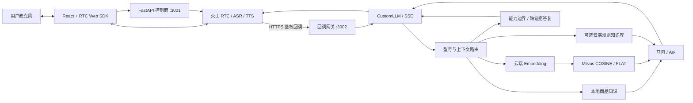

# 3C 数码电商智能导购与售后语音助手

<div align="center">

**RAG 分路检索 × Milvus 语义检索 × 实时语音对话**

React · 火山 RTC · FastAPI · Milvus · 豆包流式生成

[](LICENSE)
[](package.json)
[](rag_llm_server/pyproject.toml)
[](tsconfig.json)

[快速开始](#快速开始) · [Milvus 接入](#milvus-接入) · [真实语音](#真实语音接入) · [接口示例](#接口示例)


</div>

> 星核数码店铺、商品型号与价格均为虚构演示数据。当前提供商品与售后咨询，未接入真实订单、库存、支付、退款办理或人工坐席。

## 目录

- [项目介绍](#项目介绍)
- [核心能力](#核心能力)
- [架构与数据流](#架构与数据流)
- [快速开始](#快速开始)
- [Milvus 接入](#milvus-接入)
- [真实语音接入](#真实语音接入)
- [接口示例](#接口示例)
- [目录结构](#目录结构)
- [测试与评测](#测试与评测)
- [常见问题](#常见问题)

## 项目介绍

基于 FastAPI + Milvus + 火山方舟豆包 + RTC 的 3C 数码端到端语音导购系统，覆盖售前选型与售后政策问答；支持分路检索、证据不足即拒答、可打断的实时语音对话。

项目基于火山引擎 RTC AIGC 示例改造前端，自建 FastAPI 服务提供 RTC 控制、RAG 检索和 CustomLLM 流式回调。准确型号优先匹配本地商品资料，通用规则使用 Milvus 语义检索，也保留云知识库模式；资料不足时明确说明，避免把相似型号的参数混用。

## 核心能力

- **实时语音**：托管 ASR/TTS 与 RTC，支持语音打断、挂断重连、字幕和输入音量展示。
- **分路检索**：4 份演示文档、34 个演示 SKU、89 个本地知识单元，区分精确型号与通用规则。
- **Milvus 入库与检索**：云端 Embedding 生成2048维向量，COSINE/FLAT索引；以语料哈希及模型配置指纹限定查询范围，稳定主键支持幂等 upsert。
- **多轮追问**：利用请求中的用户历史解析“那尺寸呢”，不将助手输出当作已确认事实。
- **可追溯回答**：检索返回来源、章节、版本与检索模式，方便解释和调试。
- **能力边界**：未知型号或无证据问题澄清/拒答；订单和支付等未接入事项直接说明。
- **流式回调**：OpenAI 风格 SSE，支持首帧刷新、Bearer 鉴权、结束帧与错误兜底。
- **复现检查**：前后端自动测试、147 题回归集与 GitHub Actions 检查流程。

## 架构与数据流



Embedding、生成、ASR、TTS 和 RTC 使用云服务，Milvus 运行于本地服务。Milvus 路径校验来源、版本、正文和分数，不经过字面重合前置筛选；sample/cloud 路径保留字面相关性启发式。未接入稀疏融合或训练过的重排模型。会话保存在单个进程中，没有跨会话长期记忆。

## 快速开始

### 1. 安装依赖

需要 Node.js/npm、Python 3.13，无需本地 GPU。通过 GitHub 的 **Code → Download ZIP** 下载并解压，或克隆你发布的仓库，在根目录执行：

```bash
npm ci
cd rag_llm_server
python -m venv .venv
```

<details>
<summary>激活虚拟环境：Windows / macOS / Linux</summary>

Windows PowerShell：

```powershell
.\.venv\Scripts\Activate.ps1
```

macOS / Linux：

```bash
source .venv/bin/activate
```

后续 Python 命令均在该环境中执行，也可直接指定 `.venv` 中的 Python 路径。

</details>

```bash
python -m pip install -r requirements.txt
```

### 2. 无云密钥文本演示

复制 `rag_llm_server/.env.example` 为 `.env`，将其中两项改为：

```dotenv
KB_MODE=sample
MOCK_MODE=true
```

```bash
# rag_llm_server 目录
python main.py
```

访问 `http://127.0.0.1:3001/docs`，尝试 `/debug/rag` 与 `/debug/chat`。输出带模拟标识，演示本地检索与文本流程。真实 RTC 通话需要下一节的服务凭据。

### 3. 启动前端

另开终端，在仓库根目录执行：

```bash
npm run dev
```

打开 `http://localhost:3000`。前端默认连接当前主机的 3001 端口；尚未配置 RTC 时，获取通话场景会提示配置缺失。

## Milvus 接入

Milvus模式需要运行中的Milvus Server；本项目已在2.4.4 REST v2上验证。使用独立集合。在后端 `.env` 设置，并保留自己的Ark凭据：

```dotenv
KB_MODE=milvus
MILVUS_URI=http://127.0.0.1:19530
MILVUS_DATABASE=default
MILVUS_COLLECTION=voice_commerce_v1
MILVUS_MIN_SCORE=0.45
EMBEDDING_MODEL=doubao-embedding-vision-251215
EMBEDDING_API_PATH=/embeddings/multimodal
EMBEDDING_DIMENSIONS=2048
```

`EMBEDDING_API_KEY` 为空时复用 `ARK_API_KEY`，模型须在自己的账户开通。在后端目录激活环境后执行：

```bash
python sync_milvus.py
python sync_milvus.py --check
python main.py
```

首次导入会调用真实Embedding；相同语料和模型已有89条有效记录时跳过重复向量化。知识更新需同步更新 `knowledge/corpus.json`、重新导入并重启后端；模型或维度改变时建议使用新集合。脚本不删除旧集合和旧版本。

`/debug/knowledge` 展示集合、模型、维度和当前版本记录数；`/debug/rag` 展示检索模式、来源及分数。可选Attu管理页面：在仓库根目录执行 `docker compose -f deploy/compose.attu.yaml up -d`，访问 <http://localhost:8081>。默认通过 `host.docker.internal:19530` 连接已有Milvus，可用 `ATTU_MILVUS_ADDRESS` 覆盖。

配置、原理与排障见 [Milvus指南](docs/MILVUS.md)。

## 真实语音接入

在 `rag_llm_server/.env` 填写自己的凭据：

```dotenv
ARK_API_KEY=<your-ark-api-key>
ARK_ENDPOINT_ID=<your-model-endpoint>
VOLC_ACCESS_KEY=<your-access-key>
VOLC_SECRET_KEY=<your-secret-key>
RTC_APP_ID=<your-rtc-app-id>
RTC_APP_KEY=<your-rtc-app-key>
SERVER_URL=https://<your-public-callback-host>
CALLBACK_API_KEY=<a-long-random-secret>
KB_MODE=sample
MOCK_MODE=false
```

1. 复制 `voice_config.example.json` 为 `voice_config.json`，按实际开通的 ASR/TTS 资源核对配置。
2. 启动 Python 后端与 React 前端。
3. 在根目录执行 `node scripts/callback-gateway.cjs`，将自己的公网 HTTPS 代理或隧道指向 `127.0.0.1:3002`。
4. 将 HTTPS 地址写入 `SERVER_URL`，重新启动后端。
5. 浏览器允许麦克风，开始通话：问“SC-PB27多重”，追问“那尺寸呢”，在播报中插话验证打断。

`KB_MODE=sample` 使用本地资料，仍可连接真实模型与语音。云端规则检索需要 `KB_MODE=cloud`、账户 ID 和集合信息，见 [部署与配置](docs/DEPLOYMENT.md)。云服务按用量计费。

> `/health` 检查配置是否齐全，Milvus模式还检查当前版本记录数；这不代表服务权限、余额或真实音频已验收。公网仅暴露回调网关，调试接口保留在本机。

## 接口示例

### 检索来源

```bash
curl -G http://127.0.0.1:3001/debug/rag \
  --data-urlencode "query=SC-PB27多重"
```

返回包含 `retrieval_mode`、`sources`、`version` 和 `retrieved_context`，可区分精确型号、本地规则、Milvus、云检索与无结果。

### 文本咨询

```bash
curl -N http://127.0.0.1:3001/debug/chat \
  -H "Content-Type: application/json" \
  -d '{"question":"SC-PB27多重？","history":[]}'
```

<details>
<summary>Windows PowerShell 请求示例</summary>

```powershell
$body = @{ question = 'SC-PB27多重？'; history = @() } | ConvertTo-Json
Invoke-RestMethod -Uri 'http://127.0.0.1:3001/debug/chat' `
  -Method Post -ContentType 'application/json; charset=utf-8' -Body $body
```

</details>

### CustomLLM SSE 回调

```bash
curl -N http://127.0.0.1:3001/api/chat_callback \
  -H "Authorization: Bearer <your-callback-api-key>" \
  -H "Content-Type: application/json" \
  -d '{"messages":[{"role":"user","content":"SC-PB27多重？"}]}'
```

输出为 `text/event-stream`，以 `data: [DONE]` 结束。该接口在模拟模式仍检查 `CALLBACK_API_KEY`、`ARK_API_KEY` 与 `ARK_ENDPOINT_ID`；无需凭据的体验请使用 `/debug/chat`。

## 目录结构

```text
.
├── src/                    # React / TypeScript 语音界面
├── public/                 # 静态资源与麦克风检测页
├── rag_llm_server/         # 当前电商 FastAPI 主后端
│   ├── services/           # 检索、生成、业务边界、RTC 签名
│   ├── knowledge/          # 演示 Markdown 与本地知识单元
│   ├── .env.example        # 无密钥配置模板
│   └── voice_config.example.json
├── reproduction/          # 147 题评测集（保留 v1 的 27 题）
├── scripts/                # 公网回调网关
├── Server/                 # 上游 Node 控制面参考
├── server_python/          # 早期 Python 控制面参考
├── docs/                   # 部署配置、验证记录与上游说明
├── .github/workflows/      # GitHub Actions 检查
├── SECURITY.md
├── THIRD_PARTY_NOTICES
└── LICENSE
```

`Server`、`server_python` 是参考实现，不与主后端同时启动，避免争用 3001 端口。真实场景配置、密钥、虚拟环境、依赖、日志与构建产物由 `.gitignore` 排除。

## 测试与评测

```bash
# 仓库根目录
npm test -- --watchAll=false --runInBand
npm run build

# rag_llm_server 目录，已激活虚拟环境
python -m unittest test_reproduction test_commerce test_evaluate_commerce test_milvus -v
python evaluate_commerce.py
# 真实 Milvus / Embedding + 模拟生成
python evaluate_commerce.py --backend milvus
# 真实检索与生成（API用量）
python evaluate_commerce.py --live --backend milvus --ids 1 11

# 真实云知识库 + Ark 检查，会产生 API 费用
# 要求 KB_MODE=cloud / MOCK_MODE=false
python evaluate_commerce.py --live --cases reproduction/ecommerce_cases_v2.json
python evaluate_commerce.py --live --cases reproduction/ecommerce_cases_v2.json --ids 11 18 19
```

默认用例 `reproduction/ecommerce_cases.json` 已扩充到 147 题，与 `ecommerce_cases_v2.json` 一致；旧的 27 题保存在 `ecommerce_cases_v1.json`，可用 `--cases reproduction/ecommerce_cases_v1.json` 对照历史。`--cases` 支持绝对路径、当前目录相对路径或仓库根目录相对路径。`expect` 每项必须匹配，`reject` 任一项匹配即失败；结果分别记录 `missing_checks` 与 `violated_checks`。新增用例是评测集扩充，知识库正文仍为四份已审核演示资料。

结果写入根目录 `.runtime/`。报告包含用例文件 SHA-256、运行时间和所选 ID；重复运行时，旧报告自动加 UTC 时间戳归档。全量与 `--ids` 子集结果独立保存，不能拼接成同一轮通过数。模拟回归检查资料覆盖与规则路径；真实回归检查预设关键词，均不能代表完整事实准确率。语音识别、插话、首音延迟与持续通话需要浏览器人工验收。

2026-10-31 本地模拟关键词回归为 136/147，通过率不代表真实模型事实准确率；2026-11-02恢复核验：后端26项、前端5项测试通过，实际Milvus检索、豆包文本和SSE回调通过。历史Milvus检索＋模拟生成关键词检查为135/147，不能与旧云检索＋真实生成132/147直接比较；音频及持续通话仍需人工验收。详见[验证记录](docs/VALIDATION.md)。

## 常见问题

<details>
<summary>服务启动了，为什么无法通话？</summary>

查看 `/health` 缺项，核对 RTC 应用、ASR/TTS 资源、模型权限与配额。确认 `SERVER_URL` 为公网 HTTPS，隧道指向 3002，后端监听 3001。模拟模式拒绝真实通话启动。

</details>

<details>
<summary>麦克风无输入或没有字幕</summary>

使用 `localhost` 或 HTTPS，检查浏览器权限、输入设备与系统静音。通过前端 `/mic-check.html` 检查输入音量，再查看通话页上行码率、本机 `/debug/rtc` 与会议软件设备设置。

</details>

<details>
<summary>ASR 参数校验报错</summary>

核对模板是否与开通的服务匹配。bigmodel Credential 透传配置须提供 JSON 对象字符串形式的 `VolcanoASRParameters`，如 `"{}"`，以代码模板和账户服务要求为准。

</details>

<details>
<summary>配置或知识更新没有生效</summary>

修改 `.env` 或本地 corpus 后重启后端；前端修改后重建或重启开发服务。云知识上传提交后仍需检查索引状态。

</details>

前端及 RTC 控制示例基于火山引擎 RTC AIGC Demo 改造，保留原有 [BSD-3-Clause 许可](LICENSE)与[第三方声明](THIRD_PARTY_NOTICES)。
