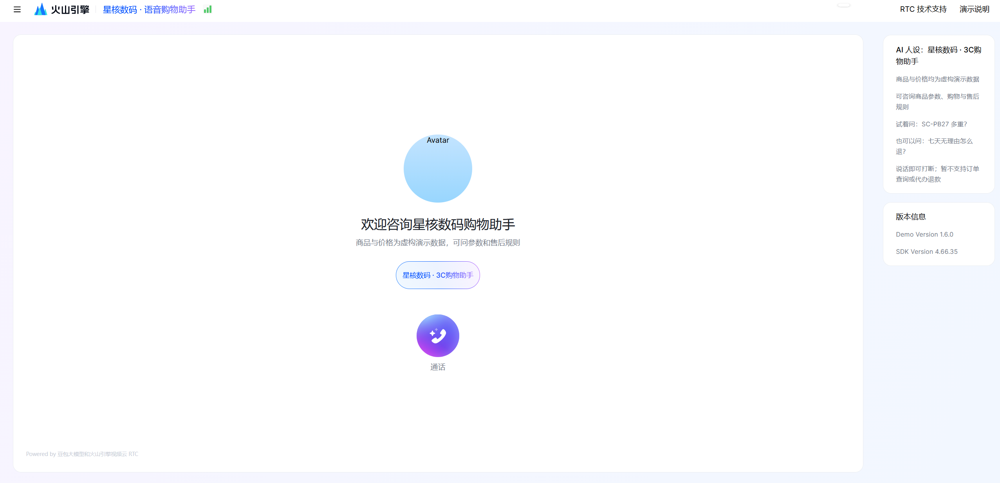
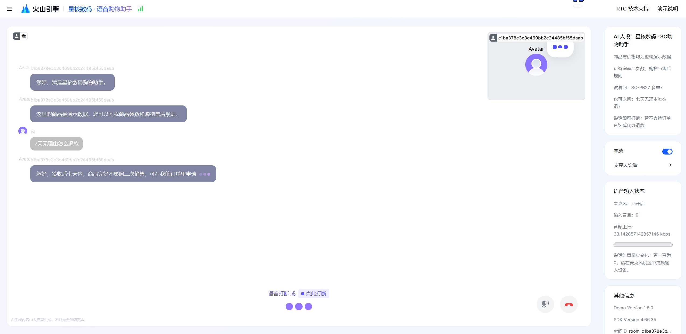
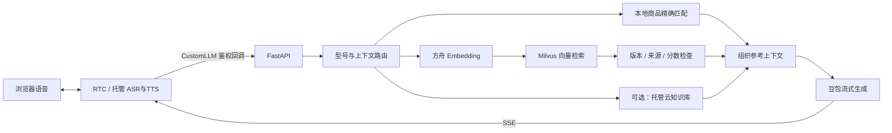

# 3C 数码电商智能导购与售后语音助手

**RAG 分路检索 × Milvus 语义检索 × 实时语音对话**

React · FastAPI · Milvus · 火山方舟豆包 · 火山 RTC

[](rag_llm_server/pyproject.toml)
[](package.json)
[](docs/MILVUS.md)

[快速开始](#快速开始) · [Milvus 接入](#milvus-接入) · [实时语音](#实时语音) · [测试与验证](#测试与验证) · [演示口播稿](docs/DEMO_SCRIPT.md)





## 项目介绍

基于 FastAPI、Milvus、火山方舟豆包与 RTC 的 3C 数码端到端语音导购系统，覆盖售前商品咨询与售后政策问答，支持分路检索、证据不足时澄清或拒答，以及可打断的实时语音对话。

具体商品型号优先精确匹配本地结构化资料；自然语言描述的规则问题通过 Embedding 向量化后检索 Milvus，再依据来源、版本和相似度过滤结果，交给豆包组织回答。保留火山托管知识库模式，可按配置切换检索后端。

星核数码店铺、商品型号与商品参数为虚构演示数据。当前未接入真实订单、库存、支付、退款办理或人工坐席。

## 核心实现

- **分路检索**：4份资料、34个演示SKU、89个知识单元；型号最长别名匹配与 Milvus 稠密语义检索分别处理。
- **向量入库**：方舟 Embedding 生成2048维向量，Milvus 使用 COSINE + FLAT；正文、来源、章节与版本信息一并保存。
- **版本与模型隔离**：根据语料哈希和 Embedding 配置指纹限定检索范围，校验返回知识单元及正文；稳定主键、幂等 upsert，相同版本已导入时跳过向量化，不删除旧集合。
- **证据约束**：未知显式型号提前拦截；低于阈值的向量结果不作为证据，最多5个知识单元、6500字符上下文。Milvus路径不使用前置字面重合门控。
- **多轮追问**：规则识别短追问，拼接最近两轮用户问题补全检索上下文，避免把助手输出当成已确认商品信息。
- **语音与流式回调**：接入 RTC 托管 ASR/TTS 与打断能力；FastAPI CustomLLM 回调先刷新合法角色帧，再检索并通过 SSE 返回正文，包含鉴权、结束帧及失败提示。
- **可观察性**：接口展示检索模式、来源、章节、分数和知识状态；自动测试及147题关键词检查使用不同口径记录。

## 问答链路



FastAPI 是接口与业务编排层，Milvus 是检索组件。当前 Milvus 模式仍使用云端 Embedding、生成及语音服务；未接入本地 BGE-M3、稀疏混合检索或训练过的重排模型。会话保存在单进程中，没有跨会话长期记忆。

## 快速开始

需要 Python 3.13、Node.js/npm。Milvus 模式还需要运行中的 Milvus Server；下面的 sample 文本演示无需 Docker、云密钥或本地 GPU。

### 1. 安装

下载本仓库，在根目录执行：

```bash
npm ci
cd rag_llm_server
python -m venv .venv
```

激活虚拟环境：PowerShell 使用 `.\.venv\Scripts\Activate.ps1`，macOS/Linux 使用 `source .venv/bin/activate`。

```bash
python -m pip install -r requirements.txt
```

复制 `rag_llm_server/.env.example` 为同目录 `.env`，真实凭据仅保存在后端。

### 2. 无密钥文本体验

在 `.env` 设置：

```dotenv
KB_MODE=sample
MOCK_MODE=true
```

在 `rag_llm_server` 目录执行 `python main.py`，打开 <http://localhost:3001/docs>，体验 `/debug/rag` 和 `/debug/chat`。模拟回答带明确标识，不代表真实模型效果。

### 3. 前端

另开终端，在仓库根目录执行 `npm run dev`，打开 <http://localhost:3000>。真实通话还需要完成下方 RTC 配置；sample 文本体验不会自动启用真实语音。

## Milvus 接入

已验证 Milvus Server 2.4.4 REST v2。使用已有 Milvus 服务时，为本项目选择独立集合；Docker 部署步骤可参考 [Milvus 官方2.4文档](https://milvus.io/docs/v2.4.x/install_standalone-docker-compose.md)。

在后端 `.env` 填写：

```dotenv
KB_MODE=milvus
MILVUS_URI=http://127.0.0.1:19530
MILVUS_DATABASE=default
MILVUS_COLLECTION=voice_commerce_v1
MILVUS_TOKEN=
MILVUS_MIN_SCORE=0.45
ARK_API_KEY=<your-ark-api-key>
EMBEDDING_MODEL=doubao-embedding-vision-251215
EMBEDDING_API_PATH=/embeddings/multimodal
EMBEDDING_DIMENSIONS=2048
```

模型须在自己的账号和区域可用。`EMBEDDING_API_KEY` 为空时复用 `ARK_API_KEY`；接口也支持 OpenAI 风格 `/embeddings`。模型、接口或维度改变时，应重新导入并优先使用新集合。

在 `rag_llm_server` 激活环境后执行：

```bash
python sync_milvus.py
python sync_milvus.py --check
python main.py
```

首次导入会调用真实 Embedding API。相同模型与语料再次执行会返回 `already_current`，不重复向量化。知识变更后更新 Markdown 与 `knowledge/corpus.json`，重新导入并重启后端。

### 可视化查看

已运行 Milvus 时，可在仓库根目录启动与2.4.x配套的 Attu：

```bash
docker compose -f deploy/compose.attu.yaml up -d
```

打开 <http://localhost:8081>，数据库选择 `default`，集合选择 `voice_commerce_v1`。此Compose默认通过 `host.docker.internal:19530` 访问本机Milvus；可用 `ATTU_MILVUS_ADDRESS` 覆盖。Schema展示2048维向量及COSINE/FLAT，数据页的 `$meta` 包含正文、章节等元数据。

6379通常是Redis服务端口，本项目Milvus连接19530，Attu网页使用8081。详细配置、阈值说明和故障排查见 [Milvus指南](docs/MILVUS.md)。

## 实时语音

在后端 `.env` 中补充：

```dotenv
ARK_ENDPOINT_ID=<your-generation-model-endpoint>
VOLC_ACCESS_KEY=<your-access-key>
VOLC_SECRET_KEY=<your-secret-key>
RTC_APP_ID=<your-rtc-app-id>
RTC_APP_KEY=<your-rtc-app-key>
SERVER_URL=https://<your-public-callback-host>
CALLBACK_API_KEY=<a-long-random-secret>
MOCK_MODE=false
```

1. 复制后端 `voice_config.example.json` 为 `voice_config.json`，核对已开通的 ASR/TTS 资源。
2. 启动后端与前端，Milvus模式下确保89条当前知识记录已就绪。
3. 仓库根目录执行 `node scripts/callback-gateway.cjs`，将自己的 HTTPS 隧道指向 `127.0.0.1:3002`。
4. 设置 `SERVER_URL`，重启后端；浏览器允许麦克风，测试商品提问、追问和插话。

云服务按用量计费。`/health` 检查配置，Milvus模式还检查当前版本知识记录；它不代表真实音频、模型权限或余额验收。公网仅暴露回调网关，调试接口保留本机。云知识库可选模式与其他配置见 [部署说明](docs/DEPLOYMENT.md)。

## 接口示例

- <http://localhost:3001/docs>：完整接口文档。
- <http://localhost:3001/debug/knowledge>：当前后端、集合、Embedding模型、维度与有效记录数，不返回密钥。

```bash
# 商品精确匹配，预期 catalog_exact
curl -G http://127.0.0.1:3001/debug/rag --data-urlencode "query=SC-PB27多重"
# Milvus语义检索，查看 sources、score 和 retrieved_context
curl -G http://127.0.0.1:3001/debug/rag --data-urlencode "query=拆开盒子以后不想要了还能退吗"
# 文本问答
curl -N http://127.0.0.1:3001/debug/chat \
  -H "Content-Type: application/json" \
  -d '{"question":"拆开盒子以后不想要了还能退吗","history":[]}'
```

RTC回调为 `POST /api/chat_callback`，要求 `Authorization: Bearer <CALLBACK_API_KEY>`，返回 OpenAI 风格 SSE，以 `data: [DONE]` 结束。模拟模式下该回调仍检查相关配置；无密钥文本体验使用 `/debug/chat`。

## 测试与验证

```bash
# 后端目录
python -m unittest test_reproduction test_commerce test_evaluate_commerce test_milvus -v
python evaluate_commerce.py
# 真实Milvus / Embedding + 模拟生成
python evaluate_commerce.py --backend milvus
# 真实检索和生成，会产生云服务用量
python evaluate_commerce.py --live --backend milvus --ids 1 11

# 仓库根目录
npm test -- --watchAll=false --runInBand
npm run build
```

2026-11-02：后端26项测试通过；Milvus89条知识记录、实际HTTP检索、真实豆包文本回答及SSE回调验证通过。当前147题“真实Milvus检索＋模拟生成”的关键词检查为135/147，不能与旧版真实模型132/147或sample检索136/147混作同一口径，尚未证明检索质量优于托管方案。

当前评测脚本报告关键词未通过项，但不会因此返回非零退出码；CI成功也不表示147题全部通过。测试覆盖、失败项与边界详见 [验证记录](docs/VALIDATION.md)。语音识别、插话及持续通话需要人工验收；本次迁移没有重新完成这些音频验收。

## 目录与运行排查

```text
src/                          React / TypeScript语音页面
rag_llm_server/
  services/rag_service.py      检索路由、来源与上下文组织
  services/milvus_service.py   Embedding与Milvus REST适配
  knowledge/                  Markdown资料与结构化知识单元
  sync_milvus.py               幂等导入与知识版本检查
deploy/compose.attu.yaml       可选数据库管理页面
scripts/callback-gateway.cjs   RTC回调网关
docs/                         配置、验证、Milvus与演示说明
```

无法通话时，先检查 `/health`、RTC与模型配置、麦克风权限及HTTPS回调；`knowledge_ready=false` 时检查Milvus是否运行，并执行 `sync_milvus.py --check`。未知型号拒答和外部服务故障是不同状态，不会将数据库故障静默当作成功检索。

前端与RTC控制示例基于火山引擎RTC AIGC Demo改造，保留原有 [BSD-3-Clause许可](LICENSE)及[第三方声明](THIRD_PARTY_NOTICES)。
