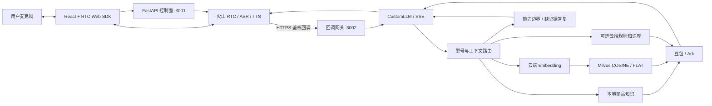

# 3C 数码电商智能导购与售后语音助手

<div align="center">

**RAG 分路检索 × Milvus 语义检索 × 实时语音对话**

React · 火山 RTC · FastAPI · Milvus · 豆包流式生成

[](LICENSE)
[](package.json)
[](rag_llm_server/pyproject.toml)
[](tsconfig.json)

[演示视频](https://b23.tv/Hl3g6z8) · [关键设计](#关键设计) · [实现与源码](#实现与源码) · [快速开始](#快速开始)

</div>

> 星核数码店铺、商品型号与价格均为虚构演示数据。当前提供商品与售后咨询，未接入真实订单、库存、支付、退款办理或人工坐席。

## 目录

- [项目介绍](#项目介绍)
- [核心能力](#核心能力)
- [实现与源码](#实现与源码)
- [架构与数据流](#架构与数据流)
- [关键设计](#关键设计)
- [快速开始](#快速开始)
- [Milvus 接入](#milvus-接入)
- [真实语音接入](#真实语音接入)
- [接口示例](#接口示例)
- [目录结构](#目录结构)
- [测试与评测](#测试与评测)
- [常见问题](#常见问题)

## 项目介绍

面向 3C 数码电商的语音咨询应用，支持商品参数查询、型号比较、售后政策问答和连续追问。用户可以直接说“SC-PB27 多重”，继续问“那尺寸呢”，也可以在助手播报时插话。

项目重点处理电商问答中的三个问题：相似型号容易混用参数，多轮追问容易丢失商品上下文，缺少资料时模型容易给出无依据的承诺。实现上采用 FastAPI + Milvus + 火山方舟豆包，将型号精确匹配、规则语义检索、回答边界控制与 RTC 实时语音链路连接起来。

前端基于火山引擎 RTC AIGC 示例改造；本仓库新增电商知识组织、RAG 分路检索、业务规则、FastAPI 控制面和 CustomLLM 流式回调。RTC、ASR、TTS 与大模型推理由云服务提供，项目侧负责应用编排与接入。

项目演示视频：[哔哩哔哩（Bilibili）](https://b23.tv/Hl3g6z8) · [飞书](https://my.feishu.cn/wiki/FW1QwXs2ZiTHfpkOje8cdwRon0e?from=from_copylink)

## 核心能力

- **商品与政策问答**：4 份演示文档、34 个演示 SKU、89 个知识单元；具体型号走精确匹配，通用规则走 Milvus 语义检索。
- **连续语音交互**：托管 ASR/TTS 与 RTC，支持语音打断、挂断重连、字幕和输入音量展示；结合用户历史补全简短追问。
- **有依据的回答**：检索结果附带来源、章节与版本，可通过调试接口查看；未知型号或无证据时提示补充信息，未接入的业务操作明确说明。
- **流式服务与排障**：OpenAI 风格 SSE 回调、Bearer 鉴权、结束帧与异常兜底；提供知识就绪检查、检索日志和 RTC 状态回调。
- **可复现验证**：前后端自动测试、147 题回归集与 GitHub Actions 检查流程，支持无云密钥的文本演示。

可用以下场景体验不同路径（行为说明，非逐字回答承诺）：

- **参数与追问**：“SC-PB27 多重？”→ 根据演示资料回答 568g；“那尺寸呢？”→ 结合用户历史定位同一型号，回答 153 × 80 × 33mm。
- **售后咨询**：“耳机拆封后能退吗？”→ 检索相关条款，提示核对拆封使用状态与对应平台公示。
- **未知型号**：“SC-PB999 多重？”→ 提示无法确认，避免套用相近型号参数。
- **业务操作**：“帮我查一下我的订单到哪了。”→ 说明未接入订单系统，引导用户到购买平台查询。

<details>
<summary>查看界面截图</summary>


</details>

## 实现与源码

在上游 RTC 示例基础上，主要实现集中在以下模块：

- **检索与上下文处理**：[rag_service.py](rag_llm_server/services/rag_service.py) 实现型号归一化、别名匹配、未知 SKU 拦截及检索路由；[commerce.py](rag_llm_server/services/commerce.py) 处理用户追问与业务边界。
- **知识入库与版本隔离**：[milvus_service.py](rag_llm_server/services/milvus_service.py) 实现 Embedding 调用、向量校验、幂等入库与检索过滤；[sync_milvus.py](rag_llm_server/sync_milvus.py) 提供导入和就绪检查入口。
- **回答生成与语音回调**：[llm_service.py](rag_llm_server/services/llm_service.py) 组织证据与提示词、接收豆包流式输出，并补充必要的售后限定语；[main.py](rag_llm_server/main.py) 实现 RTC 会话控制、回调鉴权、SSE 协议适配和调试接口。
- **接入与验证工具**：[回调网关](scripts/callback-gateway.cjs) 转发公网回调；[评测脚本](rag_llm_server/evaluate_commerce.py) 执行问答回归；[CI 配置](.github/workflows/ci.yml) 运行单元测试、模拟回归及前端构建。

## 架构与数据流



运行时，RTC 将识别后的对话发送至 CustomLLM 回调；后端先判断业务边界，再补全追问并检索资料，将证据交给豆包生成，最后通过 SSE 返回 RTC，由云端 TTS 播放。命中固定业务边界或没有证据时，直接返回预设答复。

Embedding、生成、ASR、TTS 和 RTC 使用云服务，Milvus 运行于本地服务。`sample` 模式使用本地字面匹配，`milvus` 模式使用自建向量检索，`cloud` 模式保留托管知识库接入；三者共用型号精确匹配逻辑。

## 关键设计

### 1. 型号精确匹配与语义检索分工

商品参数对型号和单位敏感，因此先做字符归一化、别名识别和精确匹配，未知显式型号直接返回无证据。售后政策等自然语言问题使用语义检索；当问题同时包含商品型号与售后诉求时，继续检索政策资料，避免只返回商品参数。

### 2. 按业务含义组织知识，隔离语料与模型版本

知识单元保留商品或规则类型、型号、别名、来源及章节。当前 89 个单元使用 2048 维向量与 COSINE / FLAT 索引；在这一数据规模下，选择全量向量比对，便于核查检索行为。

入库主键由语料哈希、Embedding 配置指纹和知识单元 ID 生成，支持重复执行 upsert；查询限定当前语料与模型配置，并校验返回内容、来源和分数，避免混用不同版本的数据。当前未接入稀疏融合或 Reranker。

### 3. 将明确的业务约束放在生成前后

订单查询、退款办理等未接入能力使用固定答复；没有检索证据时直接说明无法确认。有证据时再调用模型，通过提示词约束型号、单位与政策适用范围，并在流式输出后检查必要的售后限定语。追问补全只引用先前用户消息，避免把助手生成的型号当作检索事实。

### 4. 面向语音接入处理流式协议与故障

CustomLLM 回调适配角色帧、增量内容和 `[DONE]`，同时处理首帧获取、上游超时及流中断；公网回调通过独立网关转发，检索和 RTC 状态可在本机调试。语音打断由 RTC 能力承接，项目侧完成配置与交互接入。

当前定位为单机演示应用：会话保存在单进程内，无跨会话长期记忆，也未接入真实交易系统。后续可补充人工语义评测、端到端语音延迟与调用成本测量，再依据数据决定是否引入重排或扩展部署。

## 快速开始

### 1. 安装依赖

需要 Node.js/npm（CI 使用 Node.js 22）、Python 3.13，无需本地 GPU。通过 GitHub 的 **Code → Download ZIP** 下载并解压，或克隆本仓库，在根目录执行：

```bash
npm ci
cd rag_llm_server
python -m venv .venv
```

<details>
<summary>激活虚拟环境：Windows / macOS / Linux</summary>

Windows PowerShell：

```powershell
.\.venv\Scripts\Activate.ps1
```

macOS / Linux：

```bash
source .venv/bin/activate
```

后续 Python 命令均在该环境中执行，也可直接指定 `.venv` 中的 Python 路径。

</details>

```bash
python -m pip install -r requirements.txt
```

### 2. 无云密钥文本演示

在 `rag_llm_server` 目录复制 `.env.example` 为 `.env`，将其中两项改为：

```dotenv
KB_MODE=sample
MOCK_MODE=true
```

```bash
# rag_llm_server 目录
python main.py
```

访问 `http://127.0.0.1:3001/docs`，尝试 `/debug/rag` 与 `/debug/chat`。该模式验证本地检索与文本流程，模型生成由模拟输出替代。真实 RTC 通话需要配置[语音服务凭据](#真实语音接入)。

### 3. 启动前端

另开终端，在仓库根目录执行：

```bash
npm run dev
```

打开 `http://localhost:3000`。前端默认连接当前主机的 3001 端口；尚未配置 RTC 时，获取通话场景会提示配置缺失。

## Milvus 接入

Milvus模式需要运行中的Milvus Server；本项目已在2.4.4 REST v2上验证。使用独立集合。在后端 `.env` 设置，并保留自己的Ark凭据：

```dotenv
KB_MODE=milvus
MILVUS_URI=http://127.0.0.1:19530
MILVUS_DATABASE=default
MILVUS_COLLECTION=voice_commerce_v1
MILVUS_MIN_SCORE=0.45
EMBEDDING_MODEL=doubao-embedding-vision-251215
EMBEDDING_API_PATH=/embeddings/multimodal
EMBEDDING_DIMENSIONS=2048
```

`EMBEDDING_API_KEY` 为空时复用 `ARK_API_KEY`，模型须在自己的账户开通。在后端目录激活环境后执行：

```bash
python sync_milvus.py
python sync_milvus.py --check
python main.py
```

首次导入会调用真实Embedding；相同语料和模型已有89条有效记录时跳过重复向量化。知识更新需同步更新 `knowledge/corpus.json`、重新导入并重启后端；模型或维度改变时建议使用新集合。脚本不删除旧集合和旧版本。

`/debug/knowledge` 展示集合、模型、维度和当前版本记录数；`/debug/rag` 展示检索模式、来源及分数。可选Attu管理页面：在仓库根目录执行 `docker compose -f deploy/compose.attu.yaml up -d`，访问 <http://localhost:8081>。默认通过 `host.docker.internal:19530` 连接已有Milvus，可用 `ATTU_MILVUS_ADDRESS` 覆盖。

配置、原理与排障见 [Milvus指南](docs/MILVUS.md)。

## 真实语音接入

在 `rag_llm_server/.env` 填写自己的凭据：

```dotenv
ARK_API_KEY=<your-ark-api-key>
ARK_ENDPOINT_ID=<your-model-endpoint>
VOLC_ACCESS_KEY=<your-access-key>
VOLC_SECRET_KEY=<your-secret-key>
RTC_APP_ID=<your-rtc-app-id>
RTC_APP_KEY=<your-rtc-app-key>
SERVER_URL=https://<your-public-callback-host>
CALLBACK_API_KEY=<a-long-random-secret>
KB_MODE=sample
MOCK_MODE=false
```

1. 复制 `voice_config.example.json` 为 `voice_config.json`，按实际开通的 ASR/TTS 资源核对配置。
2. 启动 Python 后端与 React 前端。
3. 在根目录执行 `node scripts/callback-gateway.cjs`，将自己的公网 HTTPS 代理或隧道指向 `127.0.0.1:3002`。
4. 将 HTTPS 地址写入 `SERVER_URL`，重新启动后端。
5. 浏览器允许麦克风，开始通话：问“SC-PB27多重”，追问“那尺寸呢”，在播报中插话验证打断。

`KB_MODE=sample` 使用本地资料，仍可连接真实模型与语音。云端规则检索需要 `KB_MODE=cloud`、账户 ID 和集合信息，见 [部署与配置](docs/DEPLOYMENT.md)。云服务按用量计费。

> `/health` 检查配置是否齐全，Milvus 模式还检查当前版本记录数。配置完成后按上述步骤验证实际通话；公网仅暴露回调网关，调试接口保留在本机。

## 接口示例

### 检索来源

```bash
curl -G http://127.0.0.1:3001/debug/rag \
  --data-urlencode "query=SC-PB27多重"
```

返回包含 `retrieval_mode`、`sources`、`version` 和 `retrieved_context`，可区分精确型号、本地规则、Milvus、云检索与无结果。

### 文本咨询

```bash
curl -N http://127.0.0.1:3001/debug/chat \
  -H "Content-Type: application/json" \
  -d '{"question":"SC-PB27多重？","history":[]}'
```

<details>
<summary>Windows PowerShell 请求示例</summary>

```powershell
$body = @{ question = 'SC-PB27多重？'; history = @() } | ConvertTo-Json
Invoke-RestMethod -Uri 'http://127.0.0.1:3001/debug/chat' `
  -Method Post -ContentType 'application/json; charset=utf-8' -Body $body
```

</details>

### CustomLLM SSE 回调

```bash
curl -N http://127.0.0.1:3001/api/chat_callback \
  -H "Authorization: Bearer <your-callback-api-key>" \
  -H "Content-Type: application/json" \
  -d '{"messages":[{"role":"user","content":"SC-PB27多重？"}]}'
```

输出为 `text/event-stream`，以 `data: [DONE]` 结束。该接口在模拟模式仍检查 `CALLBACK_API_KEY`、`ARK_API_KEY` 与 `ARK_ENDPOINT_ID`；无需凭据的体验请使用 `/debug/chat`。

## 目录结构

```text
.
├── src/                    # React / TypeScript 语音界面
├── public/                 # 静态资源与麦克风检测页
├── rag_llm_server/         # 当前电商 FastAPI 主后端
│   ├── services/           # 检索、生成、业务边界、RTC 签名
│   ├── knowledge/          # 演示 Markdown 与本地知识单元
│   ├── .env.example        # 无密钥配置模板
│   └── voice_config.example.json
├── reproduction/          # 147 题电商问答评测集
├── scripts/                # 公网回调网关
├── Server/                 # 上游 Node 控制面参考
├── server_python/          # 早期 Python 控制面参考
├── docs/                   # 部署配置、验证记录与上游说明
├── .github/workflows/      # GitHub Actions 检查
├── SECURITY.md
├── THIRD_PARTY_NOTICES
└── LICENSE
```

`Server`、`server_python` 是参考实现，不与主后端同时启动，避免争用 3001 端口。真实场景配置、密钥、虚拟环境、依赖、日志与构建产物由 `.gitignore` 排除。

## 测试与评测

自动化验证分为接口与规则单元测试、问答用例回归、前端测试与构建。147 题用例覆盖商品参数、相似型号区分、别名与输入变体、多轮追问、售后政策、未知型号和越界请求。

```bash
# 仓库根目录
npm test -- --watchAll=false --runInBand
npm run build

# rag_llm_server 目录，已激活虚拟环境
python -m unittest test_reproduction test_commerce test_evaluate_commerce test_milvus -v
python evaluate_commerce.py
# 真实 Milvus / Embedding + 模拟生成
python evaluate_commerce.py --backend milvus
# 真实检索与生成（API用量）
python evaluate_commerce.py --live --backend milvus --ids 1 11

# 真实云知识库 + Ark 检查，会产生 API 费用
# 要求 KB_MODE=cloud / MOCK_MODE=false
python evaluate_commerce.py --live
python evaluate_commerce.py --live --ids 11 18 19
```

默认使用 `reproduction/ecommerce_cases.json` 中的 147 题电商问答用例。可通过 `--ids` 选择用例，或通过 `--cases` 指定其他用例文件；评测结果保存至仓库根目录 `.runtime/`。

问答回归使用必需关键词与禁用关键词检查，适合发现参数遗漏和规则退化，不等同于完整的语义准确率。CI 执行无云密钥检查；真实模型、Milvus 与语音体验需按对应配置单独验证。

## 常见问题

<details>
<summary>服务启动了，为什么无法通话？</summary>

查看 `/health` 缺项，核对 RTC 应用、ASR/TTS 资源、模型权限与配额。确认 `SERVER_URL` 为公网 HTTPS，隧道指向 3002，后端监听 3001。模拟模式拒绝真实通话启动。

</details>

<details>
<summary>麦克风无输入或没有字幕</summary>

使用 `localhost` 或 HTTPS，检查浏览器权限、输入设备与系统静音。通过前端 `/mic-check.html` 检查输入音量，再查看通话页上行码率、本机 `/debug/rtc` 与会议软件设备设置。

</details>

<details>
<summary>ASR 参数校验报错</summary>

核对模板是否与开通的服务匹配。bigmodel Credential 透传配置须提供 JSON 对象字符串形式的 `VolcanoASRParameters`，如 `"{}"`，以代码模板和账户服务要求为准。

</details>

<details>
<summary>配置或知识更新没有生效</summary>

修改 `.env` 或本地 corpus 后重启后端；前端修改后重建或重启开发服务。云知识上传提交后仍需检查索引状态。

</details>

前端及 RTC 控制示例基于火山引擎 RTC AIGC Demo 改造，保留原有 [BSD-3-Clause 许可](LICENSE)与[第三方声明](THIRD_PARTY_NOTICES)。
